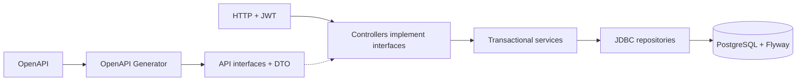

# arch_HW2 — Marketplace: OpenAPI + CRUD

Контрактный API товаров, заказов и промокодов с PostgreSQL, Flyway, JWT и ролями USER / SELLER / ADMIN.

**Стек:** Java 21, Spring Boot 3.5.7, Spring MVC, JDBC, Spring Security, OpenAPI Generator 7.15.0, PostgreSQL 17, Flyway. Java и Maven на компьютере устанавливать не обязательно: сборка, генерация и тесты выполняются в Docker.

## Запуск

Из корня репозитория:

```bash
cd arch_HW2
docker compose up --build -d --wait --wait-timeout 180
docker compose ps
docker compose logs --no-color --no-log-prefix api db
curl -i http://localhost:8081/health
```

Нужен запущенный Docker с Compose. Первый запуск скачивает зависимости. `api` и `db` должны быть `healthy`, health-check — `200` с `{"status":"ok"}`. Flyway автоматически создаёт схему до обслуживания бизнес-запросов. Порт по умолчанию **8081**, чтобы не конфликтовать с первым ДЗ на 8080.

- Swagger UI: <http://localhost:8081/swagger-ui/index.html>.
- Исходная спецификация: [marketplace.yaml](src/main/resources/openapi/marketplace.yaml), доступна также по <http://localhost:8081/openapi/marketplace.yaml>.
- Локальный ADMIN: **admin@example.test**, пароль **Admin-demo-123!**. Создаётся только при явно включённом bootstrap в Compose, публично зарегистрировать ADMIN нельзя.

Для настройки скопируйте `.env.example` в `.env`. Доступны `HOST_PORT`, `DATABASE_PASSWORD`, `JWT_SECRET`, `ADMIN_EMAIL`, `ADMIN_PASSWORD`, `ORDER_RATE_LIMIT_MINUTES`, `ACCESS_TOKEN_MINUTES`, `REFRESH_TOKEN_DAYS`. Это учебные локальные значения; для другого окружения задаются свои секреты. Существующий bootstrap-пользователь при перезапуске не пересоздаётся.

Остановка с сохранением данных:

```bash
docker compose down
```

## E2E и реальные SELECT

Одна команда после запуска приложения:

```bash
python3 scripts/demo.py
```

Нужен Python 3.10+; дополнительные Python-пакеты для демонстрации не требуются. Скрипт выполняет 45 настоящих HTTP-запросов, регистрирует продавца и покупателей, получает JWT, создаёт товар и промокод, оформляет и обновляет заказ, проверяет снимок цены, снимает скидку, отменяет заказ и архивирует товар. Проверяет ошибки 400 / 401 / 403 / 404 / 409 / 422 / 429 и модель состояний. При `ORDER_RATE_LIMIT_MINUTES=0` проверки 429 пропускаются.

Скрипт запускает `psql` через Compose, **печатает SELECT и содержимое таблиц**, проверяет остатки и счётчик промокода. Повторный запуск создаёт свои demo-объекты с уникальными именами и не очищает чужие данные. Пароли и JWT в вывод не попадают. Для нестандартного адреса можно задать `API_URL`; `.env` также учитывается.

Ручной просмотр БД:

```bash
docker compose exec -T db psql -U marketplace -d marketplace -c "SELECT id,name,price,stock,status,seller_id,created_at,updated_at FROM products ORDER BY created_at;"
docker compose exec -T db psql -U marketplace -d marketplace -c "SELECT id,user_id,status,total_amount,discount_amount,promo_code_id FROM orders ORDER BY created_at;"
docker compose exec -T db psql -U marketplace -d marketplace -c "SELECT order_id,product_id,quantity,price_at_order FROM order_items;"
docker compose exec -T db psql -U marketplace -d marketplace -c "SELECT code,current_uses,max_uses FROM promo_codes;"
docker compose exec -T db psql -U marketplace -d marketplace -c "SELECT user_id,operation_type,created_at FROM user_operations ORDER BY created_at;"
docker compose exec -T db psql -U marketplace -d marketplace -c "SELECT installed_rank,version,description,success FROM flyway_schema_history;"
```

## Контракт и кодогенерация

Источник HTTP-контракта — `src/main/resources/openapi/marketplace.yaml` (OpenAPI 3.0.3). Описаны ProductCreate, ProductUpdate, ProductResponse, заказы, промокоды, авторизация, ограничения, роли, все error codes и ответы с `X-Request-Id`.

Генерация одной командой:

```bash
docker compose --profile tools run --rm generate
```

С установленными Java 21 и Maven эквивалентно `mvn generate-sources`.

Плагин привязан к фазе Maven `generate-sources`; обычная сборка и Dockerfile вызывают его автоматически. Результат находится в `target/generated-sources/openapi/`, исключённом через `.gitignore`. Каталог `target` не копируется в Docker-образ: образ собирается из `pom.xml` и `src`, поэтому отсутствие сгенерированных файлов в Git не мешает сборке.

Контроллеры **реализуют сгенерированные интерфейсы**, все HTTP request/response/error DTO импортируются из `ru.marketplace.generated.model`. Ручных DTO для API нет. Собственные `Account`, `RefreshSession` и `Actor` — внутренние состояния хранения/аутентификации, они не используются как HTTP-модели.

Валидация генерируется из спецификации: `@NotNull`, `@Size`, `@Min`, `@Max`, `@DecimalMin`, `@Pattern`, `@Valid`. Для денежных полей из контракта генерируется `@Digits`. Ограничение уникальности product_id в заказе подключено к генерируемым моделям через vendor extension и Bean Validation. Jackson запрещает неизвестные поля и неявную подмену JSON-типов; UUID проверяется в канонической форме. Валидация происходит до вызова сервисного метода. Ошибки содержат `details.violations` с `field` и `message`.

Нулевой символ U+0000 в названии, описании, категории и фильтре категории запрещён контрактом и отклоняется до обращения к PostgreSQL.

## API и доступ

| Метод / путь | Назначение | Доступ |
|---|---|---|
| POST /auth/register | Регистрация, пароль сохраняется как PBKDF2-хеш | Публично, только USER / SELLER |
| POST /auth/login | Access JWT + refresh JWT | Публично |
| POST /auth/refresh | Ротация refresh, выдача новой пары | Публично; требуется действительный refresh |
| POST /products | Создание товара | SELLER — свой, ADMIN — любой |
| GET /products/{id} | Товар по UUID | USER / SELLER / ADMIN |
| GET /products | Фильтры и пагинация | USER / SELLER / ADMIN |
| PUT /products/{id} | Полная замена полей | SELLER — свой, ADMIN — любой |
| DELETE /products/{id} | status = ARCHIVED, запись сохраняется | SELLER — свой, ADMIN — любой |
| POST /orders | Создание заказа | USER / ADMIN |
| GET /orders/{id} | Получение заказа | USER — свой, ADMIN — любой |
| PUT /orders/{id} | Замена позиций | USER — свой, ADMIN — любой; только CREATED |
| POST /orders/{id}/cancel | Отмена с возвратом остатков и использования промо | USER — свой, ADMIN — любой |
| PATCH /orders/{id}/status | Следующий этап конечного автомата | Только ADMIN |
| POST /promo-codes | Создание промокода | SELLER / ADMIN |

Access JWT действует 15 минут (настраивается в пределах 15–30), refresh — 7 дней (7–30). Подписываются HS256, проверяются подпись, issuer, срок, role, UUID sub/jti и `token_type`. Refresh не подходит для CRUD, access не подходит для обновления токена. В БД хранится SHA-256-хеш refresh; ротация блокирует запись, отзывает старый токен и сохраняет новый в одной транзакции. Два одновременных обновления одним refresh дают один успех и один REFRESH_TOKEN_INVALID.

В Swagger сначала выполните `/auth/login`, скопируйте `access_token`, нажмите **Authorize** и вставьте сам токен. Для проверки матрицы зарегистрируйте USER и SELLER и меняйте токен. ADMIN имеет отдельный bootstrap-аккаунт.

Параметры списка: `page=0`, `size=20` по умолчанию; `size` от 1 до 100, `page` до 1 000 000. `status` и точное регистрозависимое `category` объединяются через AND. Ответ: `content`, `totalElements`, `page`, `size`; сортировка `created_at, id`. За пределами списка возвращается пустой `content` с прежним totalElements. По матрице «все товары» включает ARCHIVED; чтобы получить активные, задайте `status=ACTIVE`.

## Транзакции и бизнес-инварианты

Приложение — **модульный монолит** с пакетами API, application services, security и persistence. Это осознанное отличие от целевой схемы первого ДЗ: здесь условие требует резервировать товар и сохранять заказ **одной PostgreSQL-транзакцией**. Разнесение Catalog и Orders по приватным базам потребовало бы saga вместо данной гарантии. Сетевые микросервисы и RabbitMQ для второго задания не нужны.



- Создание выполняет проверки в порядке условия: лимит CREATE_ORDER → активный заказ → товары → все недостаточные остатки → резерв → цены и промокод → запись операции. Исключение откатывает также уже сделанный резерв.
- Обновление: владелец → CREATED → лимит UPDATE_ORDER → возврат прежнего резерва → новый резерв и снимки текущих цен → пересчёт → запись операции. Всё атомарно; при ошибке старый заказ и остатки остаются прежними.
- Отмена разрешена из CREATED и PAYMENT_PENDING. Возвращает остатки и одно использование промокода. Повторная отмена — 409, повторного возврата нет.
- При PUT товара новый доступный остаток вместе с возвращаемым резервом заказов CREATED/PAYMENT_PENDING должен помещаться в INTEGER. Проверка под блокировкой товара предотвращает переполнение при последующем обновлении или отмене заказа; нарушение возвращает VALIDATION_ERROR с полем stock.
- Конечный автомат: CREATED → PAYMENT_PENDING → PAID → SHIPPED → COMPLETED. Другие переходы запрещены. `/status` нужен для E2E-демонстрации этих состояний; реальный PSP не входит в это задание. Отмена выполняется отдельным `/cancel`.
- Операции одного владельца сериализуются блокировкой строки пользователя (`FOR NO KEY UPDATE`). Позиции блокируются по отсортированным UUID (`FOR UPDATE`), затем блокируется промокод. Это защищает последний остаток, лимит промокода и частоту операций при гонках. Дополнительно есть уникальный partial index на активный заказ пользователя.
- Лимиты CREATE_ORDER и UPDATE_ORDER независимы, фиксируются только успешные операции. При ADMIN-изменении чужого заказа применяется лимит владельца. `N` — `ORDER_RATE_LIMIT_MINUTES`; 0 отключает временной лимит, остальные проверки остаются.
- Отдельные таблицы: users, products, orders, order_items, promo_codes, user_operations, refresh_tokens. SQL-схему создаёт Flyway V1; есть индекс products(status), FK, CHECK и ENUM. created_at / updated_at заполняются БД; updated_at меняется триггером.

## Деньги и промокоды: принятые правила

В Java используется `BigDecimal`, в PostgreSQL — `DECIMAL(12,2)`. JSON-цена — number с `format: decimal`, минимум 0.01 и шагом 0.01. Время — `date-time` с часовым поясом, в БД TIMESTAMPTZ. Сумма до скидки также ограничена вместимостью DECIMAL; превышение даёт AMOUNT_LIMIT_EXCEEDED с полным откатом.

Фразу «скидка не более 70%, в ином случае цена 100%» интерпретируем буквально: **выше 70% скидка не предоставляется**, а не обрезается до 70%. Для суммы 1000: 10% → 900, 70% → 300, 80% → 1000. Валидный применённый промокод учитывается в current_uses и при нулевой скидке. FIXED_AMOUNT ограничивается суммой заказа, итог не бывает отрицательным.

Округление скидки — HALF_UP до копеек. Дополнительно процентная скидка ограничивается денежной границей 70% с округлением вниз: на сумме 0.01 скидка 70% не превращается после округления в 100%.

При создании проверяются active, срок **[valid_from, valid_until]**, наличие свободного использования и min_order_amount до скидки. При обновлении своё уже занятое использование не расходуется повторно. Невалидный/истёкший промокод даёт PROMO_CODE_INVALID и откат обновления. Для специально указанного условия снижения суммы ниже минимума скидка снимается, promo_code_id становится null, current_uses уменьшается.

## Ошибки и JSON-логи

Все ошибки возвращают `error_code`, `message`, необязательный `details`. Каталог полностью описан в OpenAPI (`ErrorCode`, responses и `x-error-catalog`), включая все обязательные коды задания. 429 содержит также Retry-After. Неправильная роль — ACCESS_DENIED; чужой заказ — ORDER_OWNERSHIP_VIOLATION; чужой товар — ACCESS_DENIED.

Каждый запрос получает новый UUID в middleware и заголовок ответа `X-Request-Id`. JSON-запись содержит request_id, method, endpoint, status_code, duration_ms, user_id, timestamp; для POST/PUT/DELETE/PATCH — request_body. Пароли, токены и секреты маскируются рекурсивно, неразбираемый JSON целиком скрывается. Логируются также 400 / 401 / 403, включая тело запроса, отклонённого до контроллера.

```bash
docker compose logs --no-log-prefix api
```

## Проверки

Интеграционные тесты запускаются с отдельной реальной PostgreSQL, не с H2:

```bash
docker compose --profile test run --rm tests
```

Тестовая БД называется `marketplace_test`. Перед очисткой фикстур тест проверяет имя БД; рабочая БД `marketplace` не очищается. Тесты проверяют ограничения, роли, JWT/refresh, денежные расчёты, SQL-состояние, rollback, статусы, JSON-логи и конкурентные запросы.

Дополнительная проверка ответов живого API по исходному контракту:

```bash
python3 -m venv .venv
.venv/bin/pip install -r requirements-dev.txt
.venv/bin/python scripts/verify_contract.py
```

Она валидирует OpenAPI и повторяет E2E, проверяя схемы, обязательные поля, enum, UUID, date-time и денежные ограничения каждого ответа. `.venv` исключена из Git.

GitHub Actions: [arch_HW2.yml](../.github/workflows/arch_HW2.yml) выполняет тесты с PostgreSQL, сборку с кодогенерацией, E2E с SELECT и проверку живых ответов по контракту. Сохраняются отчёты Surefire и обезличенные сведения E2E без токенов.

Подготовка к 20-минутной защите: [план демонстрации и объяснение кода](docs/defense.md). Соответствие критериям и альтернативные сценарии: [scenarios.md](docs/scenarios.md).

Локально проверено 21.10.2026: **84 теста, 0 ошибок**, Docker API + PostgreSQL healthy, **45 реальных HTTP-запросов с SELECT**, проверка схем живых ответов по исходному OpenAPI. Эти проверки воспроизводятся приведёнными командами; GitHub Actions запускает их после загрузки файлов в репозиторий.
