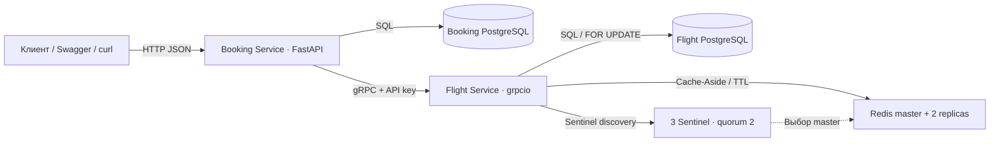

# arch_HW3 — Flight Booking: gRPC + Redis

Два микросервиса бронирования авиабилетов: REST → Booking Service → gRPC → Flight Service. У каждого собственная PostgreSQL. Flight использует Redis Cache-Aside с Sentinel; Booking — retry, Circuit Breaker и долговечную компенсацию незавершённых операций.

**Стек:** Python 3.12, FastAPI, grpcio/protobuf, psycopg, PostgreSQL 17, Alembic, Redis 7.4 + redis-py Sentinel. Java и Maven для этого проекта не нужны. Задание реализовано отдельно от `arch_HW1` и `arch_HW2`.

## Запуск

Нужен работающий Docker Desktop с Compose. Из корня репозитория:

```bash
cd arch_HW3
docker compose up --build -d --wait --wait-timeout 240
docker compose ps
curl -i http://localhost:8082/health
```

Эквивалентный основной запуск с логами: `docker compose up --build` (или `docker-compose up --build`, если установлен отдельный Compose). Миграции Alembic применяются при старте каждого приложения до запуска API. В Dockerfile protoc запускается до старта сервиса.

- REST / Swagger: <http://localhost:8082/docs>.
- REST OpenAPI: <http://localhost:8082/openapi.json>.
- gRPC: `localhost:50051`; обязательная metadata `x-api-key`.
- REST health: `GET /health` проверяет Booking DB. Flight health выполняется по аутентифицированному gRPC и проверяет Flight DB; кеш может быть временно недоступен, тогда используется PostgreSQL.

Все контейнеры должны быть healthy. Seed-рейс `00000000-0000-0000-0000-000000000001`: SVO → LED, 100 мест, 7500.00 RUB. Вылет — через 30 дней от даты первоначальной миграции, поэтому при свежем запуске дата подходит автоматически. Фильтр даты опционален.

В этом задании **нет регистрации/входа пользователя и кнопки JWT Authorize**: user_id передаётся в JSON. Ключ аутентификации защищает взаимодействие сервисов по gRPC и передаётся Booking автоматически.

## Архитектура и данные



[ER-диаграммы в 3NF](docs/er.md), [решения и trade-offs](docs/decisions.md), [каталог ошибок](docs/grpc-errors.md), [план защиты](docs/defense.md).

Резерв хранится только во Flight DB, бронирование — только в Booking DB. Связь flight_id / booking_id между БД логическая, без межсервисных SQL-запросов и FK. Название авиакомпании нормализовано в airlines. Уникальность flight_number + UTC-день задаётся expression index без дублирования даты столбцом. Ограничения количества мест, цены, IATA и времени закреплены CHECK/UNIQUE/FK.

## REST API

| Метод / путь | Поведение |
|---|---|
| GET /flights?origin=SVO&destination=LED&date=YYYY-MM-DD | gRPC SearchFlights; date опционален, только SCHEDULED |
| GET /flights/{id} | gRPC GetFlight, отсутствующий рейс — 404 |
| POST /bookings | GetFlight → ReserveSeats → CONFIRMED и snapshot стоимости |
| GET /bookings/{id} | Бронирование или 404 |
| GET /bookings?user_id=UUID | Список бронирований пользователя |
| POST /bookings/{id}/cancel | ReleaseReservation → CANCELLED, повтор — 409 |
| GET /diagnostics | Текущее состояние Circuit Breaker |

Пример бронирования:

```bash
curl -i http://localhost:8082/bookings \
  -H 'Content-Type: application/json' \
  -d '{"user_id":"00000000-0000-0000-0000-000000000101","flight_id":"00000000-0000-0000-0000-000000000001","passenger_name":"Ivan Petrov","passenger_email":"ivan@example.com","seat_count":2}'
```

Ожидается 201, статус CONFIRMED и total_price `"15000.00"`. Сохраните `id` из настоящего ответа для GET и cancel. В Swagger раскройте POST /bookings → Try it out → заполните Request body → Execute; затем GET /bookings/{booking_id} и POST /bookings/{booking_id}/cancel.

Опциональный `Idempotency-Key: UUID` делает повтор REST-запроса одним намерением. UUID становится booking_id. Тот же ключ с другим телом — 409; новый запрос без ключа создаёт новое бронирование. Деньги в JSON/protobuf — decimal-строки, в Python — Decimal, в БД — NUMERIC.

## gRPC и кодогенерация

Источник: [flight.proto](contracts/flights/v1/flight.proto). Четыре обязательных RPC: SearchFlights, GetFlight, ReserveSeats, ReleaseReservation. Дополнительно реализованы CreateFlight / UpdateFlight для подготовки рейсов и проверки инвалидации, Health для Docker.

Генерация одной командой, без локального Python/protoc:

```bash
docker compose --profile tools run --build --rm tools
```

Generated-код появляется в `generated/`, исключённом из Git. Docker-сборка независимо генерирует его из proto. Flight реализует generated servicer, Booking вызывает generated stub. Даты — google.protobuf.Timestamp, статусы — enum. Ошибки описаны в [каталоге gRPC-кодов](docs/grpc-errors.md).

Прямой gRPC-запрос через контейнер (ключ берётся из env):

```bash
echo '{"flight_id":"00000000-0000-0000-0000-000000000001"}' | docker compose exec -T flight python scripts/grpc_cli.py GetFlight
```

Проверка отсутствия ключа — ожидается UNAUTHENTICATED:

```bash
echo '{"flight_id":"00000000-0000-0000-0000-000000000001"}' | docker compose exec -T flight python scripts/grpc_cli.py GetFlight --no-auth
```

Создание собственного рейса:

```bash
docker compose exec -T flight python scripts/grpc_cli.py CreateFlight < docs/sample-flight.json
```

При повторе файла меняйте flight_number или день: пара уникальна. Для UpdateFlight передаётся `{ "flight_id": "реальный UUID", "flight": { ...полные поля... } }`. Остаток вычисляется как новая вместимость минус уже зарезервированные места.

## Транзакции и сбои

Flight резервирует available_seats и SeatReservation одной транзакцией с SELECT FOR UPDATE. Повторы booking_id не уменьшают счётчик снова. ReleaseReservation возвращает места ровно один раз. Tombstone защищает от запоздавшего резерва после отмены.

Booking сохраняет долговечный intent до gRPC. При ошибке ReserveSeats бизнес-бронирование не появляется. При ошибке локальной фиксации удалённый резерв компенсируется. Worker восстанавливает CREATING / COMPENSATING / CANCELLING после сбоя процесса. Глобальная ACID-транзакция между двумя БД не заявляется: при полном outage компенсация завершается после восстановления связи. Подробный протокол и границы гарантии — в decisions.md.

Retry находится в gRPC client interceptor: максимум 3 попытки суммарно, паузы 100/200 ms, только UNAVAILABLE и DEADLINE_EXCEEDED. Circuit Breaker — отдельный interceptor, состояния CLOSED / OPEN / HALF_OPEN. По умолчанию 5 последовательных transient-сбоев в окне 30 секунд открывают его на 10 секунд. OPEN возвращает немедленный 503 CIRCUIT_OPEN; HALF_OPEN допускает один пробный запрос. Бизнес-ошибки не повторяются и не открывают breaker.

## Redis: кеширование и Sentinel

Ключи `flight:{id}`, `search:{origin}:{destination}:{date|any}` имеют TTL 300 секунд по умолчанию, допустим диапазон 300–600. Мутации инвалидируют рейс и затронутые результаты поиска. В JSON-логах видны hit/miss/invalidation.

Sentinel: master + 2 replicas + 3 Sentinel, quorum 2. Клиент использует `Sentinel.master_for`. Для защиты от гонок и потери invalidation при асинхронном failover каждая кеш-запись сверяется с небольшой версией в PostgreSQL. Поэтому cache hit всё ещё выполняет лёгкий SELECT версии; полные данные/поиск при hit берутся из Redis. При сбое Redis используется PostgreSQL.

```bash
docker compose logs --no-log-prefix flight
docker compose exec flight python scripts/cache_status.py
docker compose exec sentinel-1 redis-cli -p 26379 SENTINEL get-master-addr-by-name flights
```

## Проверки и SELECT

После обычного запуска:

```bash
python3 scripts/demo.py
```

Нужен Python 3.10+; внешние Python-пакеты на Mac для демонстрации не требуются. Скрипт выполняет настоящий REST → gRPC флоу, печатает SELECT обеих БД, проверяет snapshot цены, ошибки, идемпотентность, возврат мест и отмену. Создаёт собственные данные, не очищает рабочие таблицы. При другом порте задайте `BOOKING_BASE_URL=http://localhost:новый_порт`.

Полный набор тестов и настоящие остановки контейнеров одной командой:

```bash
sh scripts/test.sh
```

Требуется Compose 2.24.4+ для `!override` в тестовом конфиге. Команда поднимает отдельный проект `arch-hw3-test`, отдельные volumes и БД `flight_test` / `booking_test`, порты 8092 / 50551. Выполняет pytest, E2E, останавливает Flight для демонстрации OPEN/HALF_OPEN/CLOSED, выключает Redis master для автоматического failover и весь Redis для проверки fallback. В конце удаляет **только этот изолированный тестовый стенд**. Имена БД проверяются в тестовых фикстурах, рабочие БД не очищаются.

Инъекции потери gRPC-ответа и ошибки перед фиксацией доступны только в тестовом Compose с TEST_FAULTS_ENABLED=1; в обычном запуске выключены. Тестовые заголовки скрыты из Swagger.

Ручные SELECT:

```bash
docker compose exec flight-db psql -U flight -d flight
docker compose exec booking-db psql -U booking -d booking
```

В первом клиенте:

```sql
SELECT id,flight_number,origin,destination,total_seats,available_seats,price,status FROM flights;
SELECT booking_id,flight_id,seat_count,status,price_at_reservation FROM seat_reservations;
SELECT version_num FROM alembic_version;
```

Во втором:

```sql
SELECT id,user_id,flight_id,seat_count,total_price,status FROM bookings;
SELECT booking_id,state,last_error FROM booking_operations;
SELECT version_num FROM alembic_version;
```

Выход из psql: `\q`.

## Соответствие 10 критериям

| № | Реализация | Проверка |
|---|---|---|
| 1 | contracts/flights/v1/flight.proto, protoc в Docker | Generated stub/servicer реально импортируются; Timestamp/enum/error codes |
| 2 | docs/er.md, нормализованные схемы | SQL CHECK/UNIQUE/FK, airline отдельно, два владельца данных |
| 3 | Два PostgreSQL, Alembic, FastAPI и grpcio | Одна Compose-команда, health, реальные SELECT |
| 4 | Booking вызывает GetFlight/ReserveSeats/ReleaseReservation | demo.py, интеграционные тесты, snapshot |
| 5 | FOR UPDATE + локальные транзакции + durable compensation | Гонки, rollback, потеря ответа, восстановление intent |
| 6 | Server interceptor с x-api-key, env credentials | Отсутствующий/неверный ключ для каждого RPC → UNAUTHENTICATED |
| 7 | Cache-Aside, TTL, mutation invalidation, epoch fence | Redis TTL, stale-entry test, hit/miss logs |
| 8 | Retry interceptor, максимум 3 попытки, backoff | UNAVAILABLE/DEADLINE тесты; lost-response idempotency |
| 9 | 3 Sentinel + master/2 replicas; Sentinel client | Реальное выключение master и автоматическая promotion |
| 10 | Отдельный Circuit interceptor, env параметры | Реальная остановка Flight, быстрый 503 и восстановление |

## Настройки и остановка

Скопируйте `.env.example` в `.env` для изменения порта, сервисного ключа, паролей БД, TTL и параметров retry/breaker. Значения по умолчанию — локальные демонстрационные. При замене пароля существующего PostgreSQL volume потребуется отдельно согласовать пароль пользователя БД; переменная POSTGRES_PASSWORD задаёт его при первичной инициализации.

```bash
docker compose down
```

Рабочие данные сохраняются. `.env`, generated-код и служебные evidence-файлы исключены из Git. GitHub Actions: [arch_HW3.yml](../.github/workflows/arch_HW3.yml).

Локально проверено 03.11.2026: **59 тестов прошли**, E2E с SELECT и реальные сценарии отказов завершились PASS. [Подробности проверки](docs/verification.md).
