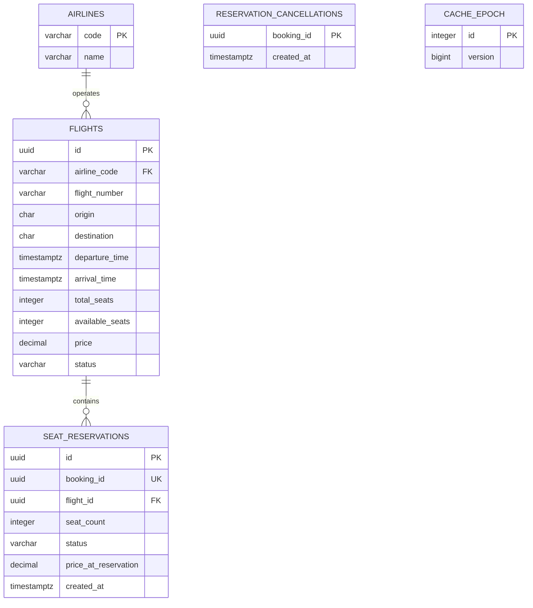
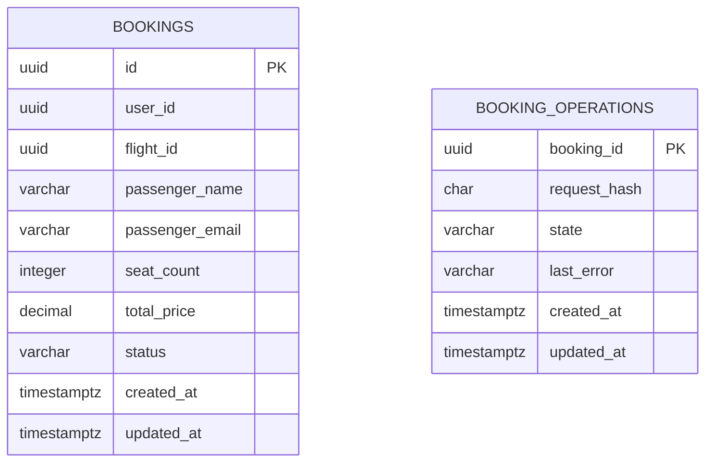

# ER-диаграммы и 3NF

Две физически отдельные PostgreSQL: Flight Service владеет `flight`, Booking Service — `booking`. У каждого собственные credentials и Alembic-миграция. Приложение не читает чужую БД; связи между сервисами реализованы через gRPC и UUID, без cross-database FK.

## Flight DB

`booking_id` в резервации — логическая ссылка на Booking Service. UNIQUE обеспечивает максимум одну резервацию на бронирование. Для каждого успешно CONFIRMED бронирования создаётся ровно одна резервация; после отмены она сохраняется со статусом RELEASED. Неуспешный workflow может оставить RELEASED-резервацию для аудита, не создавая бизнес-бронирования.

`reservation_cancellations` — долговечные tombstone-записи. Отмена неизвестного booking_id тоже сохраняет tombstone, чтобы запоздавший ReserveSeats после сетевого таймаута не занял места снова. Здесь намеренно нет FK на seat_reservations: отмена может прийти раньше резервирования.

`cache_epoch` — техническая версия опубликованных данных. Строка id=1 используется для согласования кеша и мутаций. Она не хранит сами рейсы.

## Booking DB

`booking_operations.booking_id` и `bookings.id` обозначают одну операцию. Intent существует до бронирования и может остаться без него при ошибке; сохраняется SHA-256 отпечаток запроса, а не дубликат пассажирских данных. `flight_id` — логическая ссылка на другую БД. `user_id` — внешний идентификатор клиента, таблицы пользователей это задание не требует.

## Почему 3NF

- У всех таблиц есть первичные ключи. В предметных таблицах отсутствуют массивы или повторяющиеся группы.
- Поля полностью зависят от ключа. В таблицах с UUID-ключом нет зависимости от части составного ключа.
- Название авиакомпании хранится в airlines: flights содержит только airline_code. Поэтому зависимости `flight.id → airline_code → airline_name` внутри flights нет.
- Дата вылета не дублируется отдельным столбцом. Уникальность номера рейса в пределах UTC-дня обеспечивается expression index: `(flight_number, ((departure_time AT TIME ZONE 'UTC')::date))`.
- Цена в резервации и сумма в бронировании — исторические снимки, а не копии текущего справочного значения. Последующее изменение flights.price не должно их менять.
- available_seats — явно требуемый заданием счётчик агрегата; он зависит от рейса. Согласованность с ACTIVE-резервациями поддерживается транзакционно. Это контролируемая материализация счётчика, не копирование атрибутов авиакомпании.

## Ограничения целостности

- `total_seats` от 1 до 1 000 000; `0 <= available_seats <= total_seats`.
- `price > 0`, NUMERIC(12,2); `total_price > 0`, NUMERIC(18,2).
- `seat_count` от 1 до 1000.
- arrival_time строго позже departure_time; аэропорты — разные IATA `[A-Z]{3}`.
- Уникальны пара номера рейса/UTC-дня и booking_id резервации.
- FK flights → airlines, seat_reservations → flights находятся внутри Flight DB.
- Статусы ограничены CHECK; в protobuf заданы enum. Для EXPIRED контракт и БД предусматривают значение; автоматический таймер истечения не входит в обязательное поведение этого задания и не включён.

Реальные ограничения находятся в `services/*/migrations/versions/0001_schema.py`, а не только на диаграмме.
